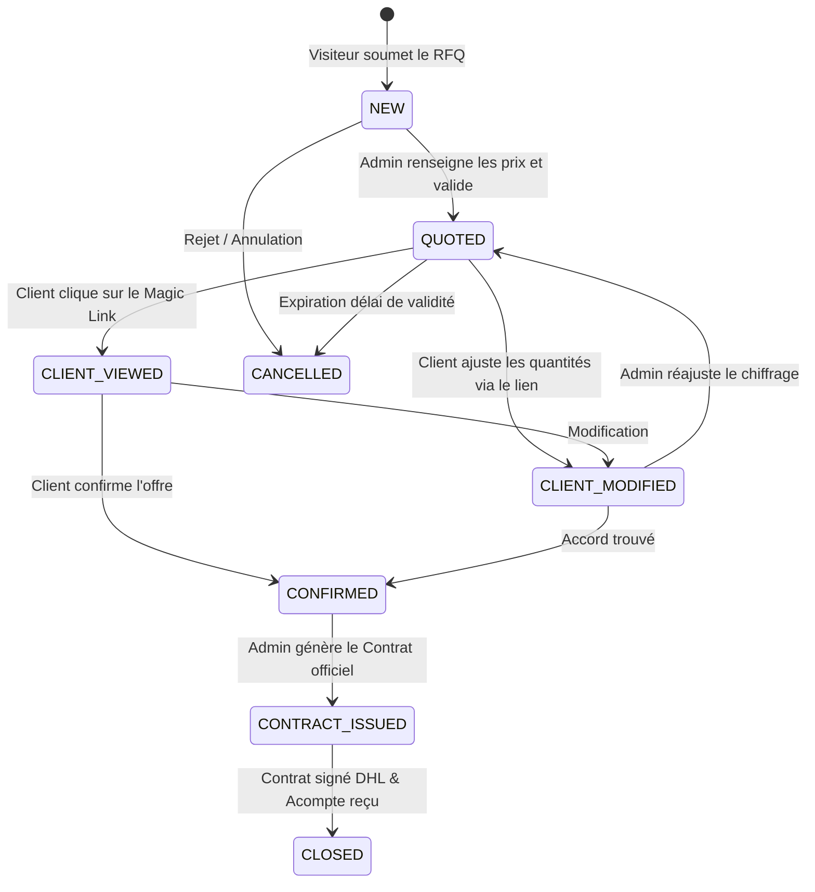

# 🔄 Module 03 — Workflows Métier & Machine d'États (State Machine)

## 1. Cycle de Vie d'un Deal B2B (State Machine)

---

## 2. Détail des Étapes Opérationnelles

### Étape 1 : Soumission RFQ (Demande de Cotation)
1. Le client compose son panier avec conditionnements et volumes.
2. Formulaire de contact B2B validé avec Captcha et vérification d'email.
3. Le système crée l'enregistrement `quotation_requests` au statut `NEW`.
4. **Automatisme :**
   - Génération d'un `signed_token` sécurisé.
   - Envoi d'un email de confirmation brandé au client (*"Votre demande est à l'étude"*).
   - Notification prioritaire par email (et Slack/WhatsApp webhook si configuré) au Super Admin.

### Étape 2 : Chiffrage par l'Admin (Cotation)
1. L'Admin ouvre la fiche Deal dans le tableau Kanban du Dashboard.
2. Il saisit le prix unitaire par ligne (`offered_unit_price`) dans la devise choisie.
3. Il définit la durée de validité du devis (ex: 10 jours) et ajoute d'éventuelles conditions de fret.
4. Au clic sur *"Envoyer l'offre"*, le statut passe à `QUOTED`.
5. **Automatisme :**
   - Génération du devis en PDF haute définition.
   - Envoi d'un email de prestige avec pièce jointe PDF et le **Magic Link sécurisé**.

### Étape 3 : Consultation & Interaction Client (Magic Link)
- URL format : `https://rayanovatd.com/{locale}/quote/review/{reference}?signature=...`
- Pas besoin de mot de passe ni de compte utilisateur.
- Le client peut :
  - **Option A :** Valider l'offre immédiatement en un clic ➔ statut `CONFIRMED`.
  - **Option B :** Ajuster les quantités / conditionnements et ajouter une note ➔ statut `CLIENT_MODIFIED` avec alerte immédiate à l'Admin.
  - **Option C :** Répondre directement à l'email reçu ➔ Le message est automatiquement rattaché au fil de discussion dans le dashboard.

### Étape 4 : Émission du Contrat & Facturation
1. Dès que l'offre est `CONFIRMED`, l'Admin accède au **Générateur de Contrats**.
2. Les coordonnées bancaires (IBAN/SWIFT), modalités de paiement (ex: 30% acompte à la commande, 70% contre remise des documents d'expédition) et documents exigés sont intégrés.
3. Génération du Contrat de Vente Internationale (PDF prêt pour DHL).
4. Émission de la Facture Pro-forma liée.
